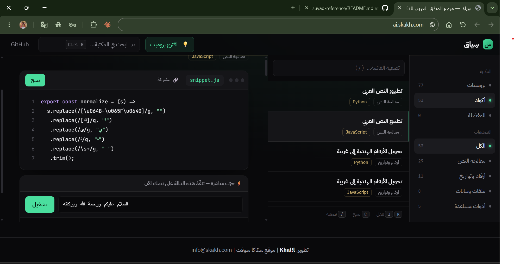

# سِياق | Suyaq

**مرجع المطوّر العربي للذكاء الاصطناعي** — 137 برومبتاً و53 كوداً عربياً جاهزة للنسخ والتجربة.
*An Arabic developer reference: ready-to-use prompts and code snippets.*

**الموقع:** https://ai.skakh.com · **الترخيص:** MIT



## المحتوى
- **برومبتات**: مراجعة كود، تلخيص، تصنيف، لهجات، SQL، استخراج JSON وغيرها، مع متغيرات `{{المدخل}}`.
- **أكواد** (Python وJavaScript): تطبيع العربي، الأرقام والتواريخ، التقطيع، التشابه، ملفات وبيانات.
- بحث فوري (Ctrl K)، ومفضلة، ونسخ بنقرة.

## كيف يعمل
`data.js` هو مصدر البيانات الوحيد، و`index.html` هو التطبيق التفاعلي. الأمر `npm run build` يولّد في `dist/` صفحات ثابتة لكل عنصر وتصنيف مع `sitemap.xml` و`robots.txt` و`rss.xml`، لتظهر المحتويات لمحركات البحث.

```bash
npm run validate   # فحص البيانات
npm run build      # توليد dist/
```
انشر محتوى `dist/` على أي استضافة ثابتة (مثل Cloudflare).

## المساهمة
اقرأ [CONTRIBUTING.md](CONTRIBUTING.md). أضف عنصراً في `data.js` وافتح Pull Request.

---

## English
Suyaq is a static Arabic-first library of prompts and code snippets. `data.js` is the single source of truth; `npm run build` (Node ≥ 18, zero dependencies) generates one crawlable page per item, category pages, `sitemap.xml`, `robots.txt`, `rss.xml` and a 404 page into `dist/`. Deploy `dist/` to any static host. MIT licensed.
